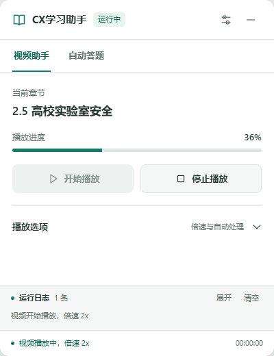
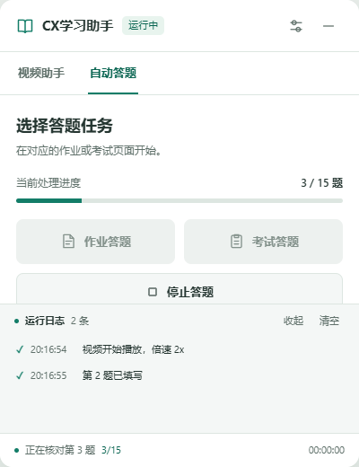

# CX学习助手

学习通课程助手用户脚本，当前版本 **1.0.5**。

[安装脚本](https://raw.githubusercontent.com/mzxuan08/chaoxing-pure/main/chaoxing-pure.user.js) · [下载发布版](https://github.com/mzxuan08/chaoxing-pure/releases)

## 功能

- 视频播放、章节推进、课件处理，播放选项可配置。
- 作业、考试、章节测验和视频弹题的识别与 AI 答题流程，支持单选、多选、判断、填空。
- 字体解码、OCR、临时请求失败重试和答案完整性校验。
- 手动停止取消请求与等待，题目发生变化时丢弃旧答案。
- 章节测验支持二次确认，核实提交结果后再推进。
- 400px 浅色悬浮面板、双页签、处理进度、最新日志、拖动和最小化。

## 安装

1. 安装支持用户脚本的浏览器扩展，例如 Tampermonkey。
2. 打开上方“安装脚本”链接；也可下载 `chaoxing-pure.user.js` 后导入扩展。
3. 若已有旧版，请在原脚本编辑器中覆盖并保存，以沿用脚本管理器的本地设置。v1.0.5 起显示名由“纯净版”改为“CX学习助手”；若安装后出现两个条目，请停用旧条目，避免重复运行。
4. 刷新学习通页面。

## 配置 API Key

公开代码不内置共享密钥。首次使用自动答题时，需要配置自己的 DeepSeek API Key：

1. 在学习通页面点击 Tampermonkey 图标。
2. 打开本脚本的“设置 DeepSeek API Key”菜单。
3. 在本机弹出的输入框中填写并保存；取消或留空会保留原设置。

配置保存在脚本管理器的本地存储中，用于向 DeepSeek 官方 API 发起请求，不会写入脚本源码、界面日志或本仓库。已有的本地配置会沿用。模型请求产生的费用由对应 API 账户结算。

界面“设置 → 清除所有数据”会同时清除保存的 API Key。不要把真实密钥、账号资料或带有这些信息的日志提交到仓库。

## 界面

以下图片来自本地模拟页面，展示界面状态，未操作在线课程。

| 视频助手 | 自动答题 |
| --- | --- |
|  |  |

## 本地检查

使用 Node.js 内置测试工具，无需安装依赖：

```sh
npm run check
npm test
```

测试使用模拟请求，不会调用真实 API。发布前另在本地浏览器中检查了界面、配置菜单及核心操作。

图片题浏览器回归：先运行 `npm install` 和 `npx playwright install chromium`，然后执行 `npm run test:browser`。这些测试也使用模拟识别与模型响应，不会请求个人 API。

## 图片文字题

v1.0.1 修复题干、选项使用图片时无法运行的问题：保留所有选项的物理顺序，逐块识别文字，按原位置填写；同时支持文字与公式图片混排，并增加数字、化学符号的二次识别。图片识别单独等待，首次使用会下载本地 OCR 所需识别数据，可能比普通文字题更慢。

识别失败会保留本题并处理后续题目；停止时释放识别引擎，题干、图片或选项变化时不使用旧答案。OCR 可能误读化学符号、上下标和百分号；纯图形关系、看不清的图或无法可靠识别的内容仍需人工检查。

## 填空题

v1.0.2 增加学习通 UEditor 富文本填空支持，兼容 iframe 编辑区、普通输入框及页面内可编辑区域。按空格顺序请求答案，校验空格数量，填写后同步编辑器与页面保存字段，并检查内容是否保留。编辑器未就绪、只读或答案数量不匹配时保留本题并继续；等待期间编辑器被替换时丢弃旧答案。

## 处理间隔

v1.0.3 将 AI 返回并填写完成后的额外答题间隔从 2–2.5 秒缩短到 0.2–0.4 秒。视频结束后约 0.2 秒开始检查下一项；同课时另一个本地视频的固定等待从约 3 秒缩至约 0.3 秒。实际切换取决于页面和视频源加载速度，章节提交确认、页面切换核实及加载失败重试继续保留。

## 视频弹题

v1.0.4 修复普通提示框被当作视频题目、共享按钮样式导致误点“下一节”的问题。弹题识别需有可见的题目和作答控件，提交与继续按钮限定在当前弹题内，不会借用课程页面的按钮或确认其他弹窗。当前视频未完成且弹题没有可用操作时，保留本节等待重查。

## 操作边界检查

v1.0.5 继续收紧通用提交和确认：拒绝“取消提交、去完成”等相似文字，点击前复核按钮含义和可见性，不借用其他任务的最终提交按钮。父页面专属确认只处理本次提交后新出现或发生变化的弹窗；题目提交后被替换仍可完成确认，停止操作会取消后续动作。章节测验的成功结果只从当前任务读取，导航不使用隐藏框架中的旧按钮。

改名保留原有设置项和存储键。仓库及安装链接保持原路径，便于已有安装沿用更新地址。

## 说明

项目整理自用户提供的学习通助手脚本，并持续修改。本仓库未另行添加许可证文件。

平台页面、播放器策略和接口可能变化。倍速可能受到平台限制；信息不足、模型不确定或答案校验不通过时仍会保留人工复核。本地检查不等于真实课程完成率或答题准确率保证。
